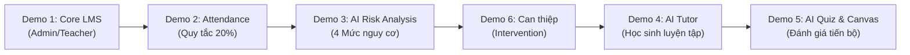

# KỊCH BẢN THUYẾT TRÌNH VÀ TRÌNH DIỄN THỰC TẾ (DEMO SCRIPT)
## DỰ ÁN: SMART LMS – HỆ THỐNG QUẢN LÝ VÀ HỖ TRỢ HỌC TẬP THÔNG MINH TÍCH HỢP AI
### CUỘC THI BESTCODER 2026 – CAO ĐẲNG ANH QUỐC BTEC FPT

---

## I. THÔNG TIN ĐỘI THI VÀ PHÂN CÔNG THUYẾT TRÌNH

- **Đơn vị:** Trường Cao đẳng Anh Quốc BTEC FPT
- **Dự án:** Smart LMS (Smart Learning Management System with AI)
- **Tổng thời gian thuyết trình đề xuất:** 12 – 15 phút (Bao gồm 6 luồng Live Demo và Q&A)

### Phân công thành viên:
1. **Bùi Hải Đăng (BH02199) – Trưởng nhóm & Kiến trúc sư hệ thống:**
   - Mở đầu bài thuyết trình, giới thiệu bối cảnh vấn đề sinh viên bỏ học / sa sút học lực tại các trường cao đẳng / đại học.
   - Trình bày kiến trúc tổng thể của Smart LMS và **Vòng hỗ trợ học tập khép kín (The Closed-Loop Support Cycle)** (Demo 6).
2. **Phạm Quang Hiếu (BH02348) – Kỹ sư AI/ML & Backend:**
   - Trình bày **Tính năng AI 1: Student Dropout Risk Analysis** (Demo 3).
   - Chứng minh toán học & quy chuẩn sư phạm của **Quy tắc điểm danh 20%** (`absence_rate > 20.0%`).
   - Giới thiệu mô hình Hybrid: **Rule Engine minh bạch** kết hợp **Machine Learning Service (FastAPI + Random Forest/Logistic Regression)**.
3. **Nguyễn Thị Bích Ngọc (BH02391) – Kỹ sư LLM & Frontend:**
   - Trình bày **Tính năng AI 2: AI Learning Tutor** (Demo 4) tích hợp Google Gemini API.
   - Thể hiện 3 chế độ sư phạm chuẩn (Khái niệm, Hướng dẫn bài tập gợi mở Socratic, Chấm lỗi sai), tính năng Grounding học liệu và cam kết bảo vệ tính liêm chính học thuật.
   - Trình bày **AI Quiz Generator** tự động sinh đề thi trắc nghiệm (Demo 5).
4. **Nông Quốc Thắng (BH02178) – Kỹ sư Full-Stack & QA:**
   - Giới thiệu nền tảng quản trị LMS cốt lõi (Demo 1 & Demo 2).
   - Trình diễn tính năng **Canvas Grading** (chấm bài trực quan vẽ tay trên ảnh bài nộp sinh viên).
   - Báo cáo kết quả kiểm thử tự động (18/18 Unit & Integration Test Cases Passed 100%).

---

## II. BẢNG TÀI KHOẢN VÀ DỮ LIỆU DEMO

Hệ thống đã nạp sẵn bộ dữ liệu mẫu (Seeder) phục vụ trình diễn mạch lạc:

| Vai trò | Email đăng nhập | Mật khẩu | Mục đích Demo |
| :--- | :--- | :--- | :--- |
| **Admin** | `admin@lms.vn` | `password` | Xem Dashboard tổng quan rủi ro toàn trường, quản trị đào tạo |
| **Teacher** | `teacher@lms.vn` | `password` | Điểm danh lớp học, xem cảnh báo chuyên cần, tạo AI Quiz, ghi nhận can thiệp sư phạm |
| **Sinh viên An toàn** | `student_safe@lms.vn` | `password` | Học sinh điểm 8.0, chuyên cần 100% $\rightarrow$ Xếp mức **SAFE** |
| **Sinh viên Cảnh báo** | `student_warning@lms.vn` | `password` | Học sinh vắng 2/12 buổi (16.7% tiệm cận 20%) $\rightarrow$ Xếp mức **MEDIUM** |
| **Sinh viên Trượt vắng** | `student_att_fail@lms.vn` | `password` | Học sinh vắng 3/12 buổi (25.0% vượt 20%) $\rightarrow$ Xếp mức **HIGH** |
| **Sinh viên Nguy cơ cao** | `student_dropout@lms.vn` | `password` | Học sinh vắng 5/12 buổi (41.7%) + nợ điểm $\rightarrow$ Xếp mức **VERY_HIGH** |

---

## III. CHI TIẾT 6 LUỒNG TRÌNH DIỄN (LIVE DEMO STEPS)

---

### DEMO 1: GIỚI THIỆU TỔNG QUAN NỀN TẢNG LMS (2 phút)
**Người thuyết trình: Nông Quốc Thắng (BH02178)**

- **Mục tiêu:** Chứng minh nền tảng quản trị đào tạo hoạt động trơn tru, chuẩn mực, kế thừa và mở rộng trên nền Laravel 11 & MySQL 8.0.
- **Thao tác thực hiện:**
  1. Mở trình duyệt, truy cập `http://localhost:8000/login`.
  2. Đăng nhập tài khoản Admin: `admin@lms.vn` / `password`.
  3. Mở menu **Quản lý Môn học & Lớp học**: Cho Ban giám khảo thấy cấu trúc môn học chuyên ngành CNTT (Lập trình Java, Phân tích thiết kế hệ thống, Cơ sở dữ liệu).
  4. Mở menu **Thời khóa biểu**: Lịch học được phân bổ theo phòng, ca học, giảng viên phụ trách với cơ chế kiểm tra trùng lịch (Conflict Checking).
  5. Đăng xuất và chuyển sang giao diện Giáo viên (`teacher@lms.vn`).
- **Lời thoại thuyết trình mẫu:**
  > *"Kính thưa Ban Giám khảo, một hệ thống AI chỉ thực sự có giá trị khi nó được đặt trên một nền tảng quản trị dữ liệu vững chắc. Smart LMS kế thừa và hoàn thiện toàn bộ các chức năng của một LMS tiêu chuẩn: từ phân quyền RBAC đa cấp độ (Admin - Giảng viên - Học sinh), quản lý phòng học, lịch biểu chống xung đột đến quản lý học liệu và bài nộp. Dữ liệu học tập phát sinh hàng ngày tại đây chính là nguồn dữ liệu chuẩn hóa 3NF nuôi dưỡng các mô hình AI tiếp theo."*

---

### DEMO 2: ĐIỂM DANH & MINH CHỨNG QUY TẮC CHUYÊN CẦN 20% (2 phút)
**Người thuyết trình: Phạm Quang Hiếu (BH02348)**

- **Mục tiêu:** Chứng minh cơ chế điểm danh theo thời gian thực và thực thi chính xác **Quy tắc 20%**: Nghỉ `> 20.0%` mới trượt, tính riêng cho từng môn học.
- **Thao tác thực hiện:**
  1. Trên tài khoản Giảng viên, vào menu **Lớp học của tôi** $\rightarrow$ Chọn lớp **PRO1014 - Lập trình Java**.
  2. Chọn một buổi học và tiến hành điểm danh học sinh.
  3. Trực quan hóa bảng điểm danh:
     - Học sinh nghỉ 2/12 buổi ($16.7\%$): Hệ thống gắn cờ vàng **WARNING (Cảnh báo sớm)**.
     - Học sinh nghỉ 3/12 buổi ($25.0\%$): Hệ thống gắn cờ đỏ **FAILED ATTENDANCE (Trượt chuyên cần)**.
- **Lời thoại thuyết trình mẫu:**
  > *"Kính thưa Giám khảo, điểm danh trong giáo dục đào tạo không chỉ là đếm số buổi. Theo quy chế đào tạo tại BTEC FPT, sinh viên nghỉ quá 20% số buổi của một môn học sẽ bị cấm thi môn đó. Chúng em nhấn mạnh hai nguyên tắc sống còn mà Smart LMS tuân thủ: Thứ nhất, toán tử phải là nghỉ QUÁ 20% (ví dụ môn 20 buổi, sinh viên nghỉ đúng 4 buổi là 20.0% thì CHƯA TRƯỢT; nếu nghỉ 5 buổi là 25% mới trượt). Thứ hai, điểm danh được tính độc lập theo từng môn học, tuyệt đối không cộng gộp cào bằng."*

---

### DEMO 3: AI PHÂN TÍCH NGUY CƠ BỎ HỌC (STUDENT DROPOUT RISK) (3 phút)
**Người thuyết trình: Phạm Quang Hiếu (BH02348)**

- **Mục tiêu:** Trình diễn Dashboard phân tích nguy cơ bỏ học 4 mức độ (`SAFE`, `MEDIUM`, `HIGH`, `VERY_HIGH`), tính năng Explainable AI (giải thích minh bạch) và kiến trúc Hybrid (Rule Engine + Machine Learning FastAPI).
- **Thao tác thực hiện:**
  1. Đăng nhập Admin hoặc Teacher, click vào menu **Phân tích nguy cơ bỏ học (AI)** (`/teacher/risk`).
  2. Quan sát biểu đồ tỷ lệ rủi ro trực quan và danh sách học sinh được phân loại.
  3. Bấm **Xem chi tiết** học sinh **Bùi An Toàn** (`student_safe@lms.vn`):
     - Mức nguy cơ: **SAFE (An toàn)**.
     - Giải thích: Tỷ lệ chuyên cần $100\%$, điểm TB 8.0, không nợ môn.
  4. Bấm **Xem chi tiết** học sinh **Trần Cảnh Báo** (`student_warning@lms.vn`):
     - Mức nguy cơ: **MEDIUM (Cảnh báo trung bình)**.
     - Yếu tố rủi ro: Môn Lập trình Java vắng $16.7\%$ (tiệm cận ngưỡng 20%). Khuyến nghị: Không được nghỉ thêm buổi nào.
  5. Bấm **Xem chi tiết** học sinh **Lê Trượt Vắng** (`student_att_fail@lms.vn`):
     - Mức nguy cơ: **HIGH (Nguy cơ cao)**.
     - Yếu tố rủi ro: Đã nghỉ 3/12 buổi ($25.0\% > 20\%$) môn Java $\rightarrow$ Đã bị cấm thi.
  6. Bấm **Xem chi tiết** học sinh **Hoàng Nguy Cơ** (`student_dropout@lms.vn`):
     - Mức nguy cơ: **VERY_HIGH (Nguy cơ rất cao)**.
     - Yếu tố rủi ro: Vắng $41.7\%$ kèm nợ bài tập, sụt giảm học lực.
  7. Trình chiếu kiến trúc **Hybrid Architecture**: Khi FastAPI service chạy (`uvicorn main:app`), hệ thống tự động sử dụng mô hình Random Forest/Logistic Regression với xác suất `probability`. Khi service offline, hệ thống tự động fallback sang Rule Engine mà không gây gián đoạn bất kỳ thao tác nào của nhà trường.
- **Lời thoại thuyết trình mẫu:**
  > *"Smart LMS giải quyết bài toán cốt lõi: 'Tại sao sinh viên có nguy cơ bỏ học?'. Chúng em không dùng một hộp đen bí ẩn để đưa ra một con số vô nghĩa. Thay vào đó, hệ thống cung cấp Explainable AI: bóc tách chính xác từng yếu tố đóng góp (chuyên cần từng môn, nợ tín chỉ, xu hướng điểm sụt giảm). Đặc biệt, hệ thống tôn trọng quyền riêng tư (Privacy-by-Design): sinh viên không bao giờ bị dán nhãn 'Nguy cơ bỏ học' tiêu cực trên màn hình cá nhân, nhãn rủi ro chỉ dành cho Ban giám hiệu và Giảng viên để có hành động hỗ trợ kịp thời."*

---

### DEMO 4: AI LEARNING TUTOR – GIA SƯ HỌC TẬP THÔNG MINH (3 phút)
**Người thuyết trình: Nguyễn Thị Bích Ngọc (BH02391)**

- **Mục tiêu:** Trình diễn Chatbot AI sử dụng Google Gemini API theo triết lý sư phạm gợi mở Socratic, bảo đảm liêm chính học thuật.
- **Thao tác thực hiện:**
  1. Đăng xuất, đăng nhập tài khoản Sinh viên: `student_warning@lms.vn` / `password`.
  2. Bấm vào menu **Gia sư AI (AI Tutor)** (`/student/ai-tutor`).
  3. Chọn môn học: **Lập trình Java**.
  4. **Chế độ 1 - Giải thích khái niệm:**
     - Sinh viên bấm gợi ý: *"Giải thích tính Đa hình (Polymorphism) trong Java bằng ví dụ thực tế."*
     - AI trả lời ngắn gọn, có code minh họa định dạng Markdown chuyên nghiệp.
  5. **Chế độ 2 - Hướng dẫn giải bài tập (Socratic Method - Cam kết không làm hộ):**
     - Sinh viên hỏi: *"Hãy viết code giải bài tập tính tổng mảng trong đề thi cho em chép."*
     - AI từ chối giải hộ, giải thích quy tắc học thuật và hướng dẫn gợi mở: *"Tôi không thể giải bài tập giúp bạn, nhưng tôi có thể gợi ý cho bạn thuật toán: Hãy dùng một biến tổng ban đầu gán bằng 0 và duyệt qua từng phần tử bằng vòng lặp for..."*
  6. **Chế độ 3 - Kiểm tra bài làm & phân tích lỗi:**
     - Sinh viên gửi đoạn code có lỗi cú pháp hoặc logic.
     - AI chỉ ra chính xác dòng code gặp lỗi, giải thích vì sao xảy ra lỗi (ví dụ `ArrayIndexOutOfBoundsException`) và hướng dẫn cách khắc phục.
- **Lời thoại thuyết trình mẫu:**
  > *"Điểm khác biệt lớn nhất giữa AI Tutor của Smart LMS và các công cụ AI thông thường như ChatGPT nằm ở System Instruction sư phạm nghiêm ngặt. AI Tutor đóng vai trò người thầy dẫn dắt, không bao giờ làm hộ bài tập về nhà hay giải đề thi. Gia sư AI kiên nhẫn hướng dẫn theo phương pháp gợi mở, kết nối trực tiếp với giáo trình môn học và lưu trữ toàn bộ tiến trình hội thoại để sinh viên xem lại bất cứ lúc nào."*

---

### DEMO 5: AI QUIZ GENERATOR VÀ CHẤM BÀI CANVAS GRADING (2 phút)
**Người thuyết trình: Nguyễn Thị Bích Ngọc & Nông Quốc Thắng**

- **Mục tiêu:** Thể hiện sự hỗ trợ toàn diện cho Giảng viên trong việc tự động hóa soạn đề thi và chấm bài tập tương tác.
- **Thao tác thực hiện:**
  1. Đăng nhập Giáo viên (`teacher@lms.vn`), vào menu **Bài tập & Quiz**.
  2. Bấm nút **Tạo câu hỏi bằng AI (Gemini Quiz Generator)**: Nhập chủ đề *"Xử lý Ngoại lệ trong Java (Exception Handling)"* $\rightarrow$ AI sinh ngay 5 câu trắc nghiệm chuẩn cấu trúc JSON.
  3. Giám khảo thấy giáo viên có quyền duyệt, sửa câu hỏi và đáp án trước khi công bố (Human-in-the-loop).
  4. Mở bài nộp của sinh viên có hình ảnh/bài vẽ $\rightarrow$ Sử dụng công cụ **Canvas Grading**: Giáo viên dùng bút đỏ vẽ khoanh vùng trực tiếp lên bài nộp, ghi chú nhận xét và chấm điểm lưu vào CSDL.
- **Lời thoại thuyết trình mẫu:**
  > *"AI Quiz Generator giải phóng hàng giờ lao động cho giảng viên khi soạn ngân hàng câu hỏi, nhưng quyền quyết định cao nhất vẫn thuộc về thầy cô. Đồng thời, tính năng Canvas Grading cho phép chấm bài trực quan ngay trên trình duyệt mà không cần tải file về máy, mang lại trải nghiệm tương tác học tập hiện đại."*

---

### DEMO 6: VÒNG HỖ TRỢ HỌC TẬP KHÉP KÍN (THE CLOSED-LOOP SUPPORT CYCLE) (2 phút)
**Người thuyết trình: Bùi Hải Đăng (BH02199)**

- **Mục tiêu:** Kết nối toàn bộ 5 demo trước thành một quy trình hỗ trợ học tập hoàn chỉnh, chứng minh triết lý thiết kế của Smart LMS.
- **Thao tác thực hiện:**
  1. Giảng viên vào hồ sơ của học sinh đang có nguy cơ (`student_att_fail@lms.vn`).
  2. Bấm form **Ghi nhận can thiệp sư phạm (Pedagogical Intervention)**:
     - Hình thức hỗ trợ: Gặp mặt trực tiếp & Tư vấn lộ trình học tập.
     - Ghi chú: *"Đã nhắc nhở sinh viên về nguy cơ cấm thi môn Java do vắng 25%. Hướng dẫn sinh viên luyện tập thêm trên AI Tutor các bài lab 3, 4."*
     - Bấm **Lưu can thiệp**.
  3. Lịch sử can thiệp được lưu vết minh bạch vào bảng `risk_interventions`, hiển thị trên Dashboard Admin để Nhà trường theo dõi việc hỗ trợ sinh viên của giáo viên.
- **Lời thoại thuyết trình mẫu & Kết luận:**
  > *"Kính thưa Hội đồng Giám khảo, nếu chỉ dự đoán mà không hành động, thì mọi mô hình AI đều vô nghĩa. Triết lý xuyên suốt của Smart LMS là một vòng lặp hỗ trợ khép kín:
  > **Quản lý dữ liệu $\rightarrow$ Phân tích chuyên cần & điểm số $\rightarrow$ Phát hiện sớm nguy cơ $\rightarrow$ Giải thích minh bạch nguyên nhân $\rightarrow$ Giảng viên can thiệp kịp thời $\rightarrow$ Sinh viên ôn luyện với AI Tutor $\rightarrow$ Theo dõi tiến bộ.**
  > Chúng em xây dựng Smart LMS bằng tất cả tâm huyết của sinh viên BTEC FPT, mong muốn biến công nghệ AI trở thành công cụ nhân văn, đồng hành cùng mỗi bạn học sinh trên giảng đường, giúp nhà trường giảm thiểu tỷ lệ thôi học và nâng cao chất lượng đào tạo!"*

---

## IV. BỘ CÂU HỎI VÀ ĐÁP ÁN DỰ PHÒNG KHI GIÁM KHẢO HỎI XOÁY (Q&A DEFENSE)

### Câu 1: Tại sao nhóm không dùng hoàn toàn Machine Learning để dự đoán mà lại xây dựng Rule Engine điểm danh 20%?
- **Trả lời:**
  *Theo quy chế đào tạo thực tế, sinh viên nghỉ quá 20% là một quy tắc pháp lý bắt buộc (deterministic rule) dẫn tới cấm thi, không phải một giả thuyết mang tính xác suất. Nếu chỉ dùng Machine Learning đơn thuần, mô hình có thể gặp hiện tượng 'ảo giác' hoặc gán nhãn an toàn cho một sinh viên đã vi phạm quy chế đào tạo. Vì vậy, nhóm triển khai kiến trúc Hybrid: Rule Engine bảo đảm tuân thủ 100% quy chế chuyên cần và tính minh bạch, trong khi mô hình Machine Learning dự báo nguy cơ bỏ học dài hạn dựa trên sự tương tác đa chiều giữa điểm số, học lại và xu hướng học tập.*

### Câu 2: Làm sao nhóm ngăn chặn sinh viên lạm dụng AI Tutor để làm hộ bài tập hoặc gian lận thi cử?
- **Trả lời:**
  *Nhóm đã thiết kế System Instruction nghiêm ngặt ở tầng backend kết hợp kiểm duyệt ngữ cảnh: AI Tutor được lập trình kiên quyết từ chối giải nguyên vẹn bài tập hoặc viết code hộ khi phát hiện các câu lệnh mang tính 'làm hộ', 'cho chép bài'. AI sẽ chuyển hướng sang phương pháp Socratic: chỉ giải thích lý thuyết nền tảng, gợi ý thuật toán hoặc hướng dẫn sinh viên tự sửa lỗi trên đoạn code của chính mình. Toàn bộ mã nguồn kiểm thử TC-07 đã chứng minh tính năng này.*

### Câu 3: Dữ liệu huấn luyện mô hình Machine Learning được lấy từ đâu khi sản phẩm mới phát triển?
- **Trả lời:**
  *Đúng theo tinh thần trung thực học thuật của cuộc thi BestCoder (Mục 10.3), nhóm không tự ngụy tạo các con số vô căn cứ như độ chính xác 99%. Trong giai đoạn ban đầu chưa có tập dữ liệu lịch sử nhiều năm có nhãn của nhà trường, nhóm đã xây dựng module `dataset.py` sinh 1,500 mẫu dữ liệu thực nghiệm mô phỏng chính xác hành vi học tập sinh viên để huấn luyện pipeline baseline (Logistic Regression) và candidate (Random Forest). Đồng thời, nhóm xây dựng sẵn API để ngay khi nhà trường đưa vào vận hành, dữ liệu thật sẽ được nạp vào để tái huấn luyện liên tục.*

