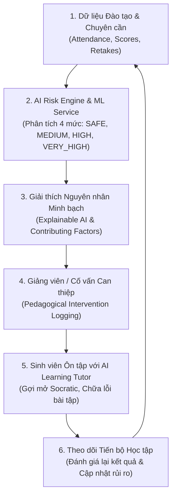

# SMART LMS – Hệ Thống Quản Lý Và Hỗ Trợ Học Tập Thông Minh Tích Hợp AI

> **Dự án dự thi BestCoder 2026 – Trường Cao đẳng Anh Quốc BTEC FPT**  
> *Đội ngũ phát triển:*  
> 1. Bùi Hải Đăng – BH02199 (Trưởng nhóm, Software Architect & Full-Stack Lead)  
> 2. Nguyễn Thị Bích Ngọc – BH02391 (LLM Engineer & Frontend Lead)  
> 3. Phạm Quang Hiếu – BH02348 (AI/ML Engineer & Backend Lead)  
> 4. Nông Quốc Thắng – BH02178 (Full-Stack Engineer & QA Lead)  

---

## I. TỔNG QUAN DỰ ÁN

**Smart LMS** không chỉ là một cổng thông tin quản lý đào tạo đơn thuần, mà là một **hệ sinh thái hỗ trợ học tập thông minh khép kín** nhằm giải quyết vấn đề nan giải trong giáo dục hiện đại: **Tỷ lệ sinh viên sa sút học lực và bỏ học sớm**.

Hệ thống kết hợp ba trụ cột công nghệ vững chắc:
1. **Nền tảng Quản trị Đào tạo (Core LMS):** Quản lý người dùng RBAC (Admin, Teacher, Student), môn học, lớp học, thời khóa biểu chống trùng lịch, điểm danh thời gian thực, quản lý học liệu và nộp bài tập.
2. **AI Phân Tích Nguy Cơ Bỏ Học (Student Dropout Risk Analysis):** Hệ thống cảnh báo sớm dựa trên luật chuyên cần sư phạm nghiêm ngặt (Quy tắc 20%) và mô hình học máy (Machine Learning) đa chiều (GPA, nợ môn, học lại, xu hướng học tập), phân loại 4 mức nguy cơ kèm giải thích minh bạch (Explainable AI).
3. **AI Learning Tutor (Gia Sư Học Tập Thông Minh):** Trợ lý học tập cá nhân hóa tích hợp Google Gemini API với System Instruction chuẩn mực: kiên quyết từ chối giải hộ bài tập, dẫn dắt học sinh theo phương pháp gợi mở Socratic và kết nối chặt chẽ với giáo trình môn học.

---

## II. TRIẾT LÝ THIẾT KẾ: VÒNG LẶP HỖ TRỢ HỌC TẬP KHÉP KÍN



---

## III. CÔNG NGHỆ SỬ DỤNG

- **Backend:** PHP 8.2+, Laravel 11 (Routing, Eloquent ORM, Middleware RBAC, Database Transactions, Service Layer).
- **Frontend:** Laravel Blade, Tailwind CSS, JavaScript ES6, HTML5 Canvas API (cho tính năng Canvas Grading), Chart.js.
- **Database:** MySQL 8.0 chuẩn hóa 3NF, Foreign Keys & Indexes tối ưu hóa truy vấn.
- **AI & LLM:** Google Gemini 1.5 Pro / Flash API, Prompt Engineering, Structured JSON Validation, Socratic System Instructions.
- **Machine Learning Service:** Python 3.10+, FastAPI, Scikit-Learn (Logistic Regression Baseline & Random Forest Candidate), Pandas, NumPy, Joblib.
- **Kiểm thử (Testing):** Bộ kiểm thử tự động toàn diện 18/18 Test Cases đạt kết quả 100% Passed.

---

## IV. BẢNG PHÂN LOẠI 4 MỨC NGUY CƠ BỎ HỌC

| Mức nguy cơ | Màu sắc | Tiêu chí phân loại | Khuyến nghị hành động |
| :--- | :---: | :--- | :--- |
| **SAFE** | 🟢 Xanh lá | PASS toàn bộ môn, vắng $< 15\%$, không học lại, điểm TB $\ge 6.5$. | Duy trì phong độ, nghiên cứu sâu chuyên ngành với AI Tutor. |
| **MEDIUM** | 🟡 Vàng | Có môn vắng $15\% - 20\%$ (tiệm cận ngưỡng cấm thi) hoặc nợ 1 môn điểm kém. | Cảnh báo sớm, nhắc nhở không được nghỉ thêm buổi nào, hoàn thành bài tập còn thiếu. |
| **HIGH** | 🟠 Cam | Vắng $> 20.0\%$ ở 1 môn (đã bị cấm thi) HOẶC nợ từ 2 môn trở lên. | Giảng viên trực tiếp can thiệp, lên lịch phụ đạo cá nhân hóa. |
| **VERY_HIGH** | 🔴 Đỏ | Vắng $> 20.0\%$ ở nhiều môn HOẶC vắng $\ge 35\%$ kèm nợ môn nghiêm trọng. | Buổi gặp mặt khẩn cấp Ban Đào tạo, Cố vấn và Sinh viên; tái cấu trúc lộ trình học tập. |

---

## V. TÀI KHOẢN VÀ KỊCH BẢN THUYẾT TRÌNH

- Mật khẩu đăng nhập mặc định cho toàn bộ tài khoản: **`password`**
- **Admin:** `admin@lms.vn` (Quản trị hệ thống, Dashboard rủi ro toàn trường)
- **Giảng viên:** `teacher@lms.vn` (Điểm danh, xem cảnh báo lớp học, chấm bài Canvas, tạo AI Quiz)
- **Sinh viên An toàn:** `student_safe@lms.vn` (Mức SAFE)
- **Sinh viên Cảnh báo:** `student_warning@lms.vn` (Mức MEDIUM - Vắng 16.7%)
- **Sinh viên Trượt vắng:** `student_att_fail@lms.vn` (Mức HIGH - Vắng 25.0%)
- **Sinh viên Nguy cơ cao:** `student_dropout@lms.vn` (Mức VERY_HIGH - Vắng 41.7%)

Chi tiết kịch bản thuyết trình và 6 bài demo từng phút xem tại:  
👉 [`KICH_BAN_DEMO_BESTCODER_2026.md`](file:///c:/xampp/htdocs/CLONE_SDLC/LMS_SDLC_SE08201/LMS_SDLC_SE08201/KICH_BAN_DEMO_BESTCODER_2026.md)

Hướng dẫn cài đặt chi tiết từng bước xem tại:  
👉 [`HUONG_DAN_CAI_DAT_VA_VAN_HANH.md`](file:///c:/xampp/htdocs/CLONE_SDLC/LMS_SDLC_SE08201/LMS_SDLC_SE08201/HUONG_DAN_CAI_DAT_VA_VAN_HANH.md)

---

## VI. BẰNG CHỨNG KIỂM THỬ (TEST RESULTS)

Hệ thống đã trải qua kiểm thử độc lập và toàn diện:

```
========================================================================
       BỘ KIỂM THỬ TOÀN DIỆN BESTCODER 2026 — SMART LMS TESTING         
========================================================================
 [PASS] TC-01: Nghỉ dưới 20% (3/20 buổi = 15%) chưa trượt chuyên cần
 [PASS] TC-02: Nghỉ ĐÚNG 20% (4/20 buổi = 20.0%) CHƯA TRƯỢT chuyên cần
 [PASS] TC-03: Nghỉ TRÊN 20% (5/20 buổi = 25.0%) TRƯỢT điều kiện chuyên cần
 [PASS] TC-04: Học sinh PASS toàn bộ, chuyên cần 100% được xếp mức AN TOÀN
 [PASS] TC-05: Học sinh vắng 3/12 buổi (25%) bị cảnh báo nguy cơ cao & có yếu tố CRITICAL
 [PASS] TC-06: Học sinh vắng 41.7% + điểm kém xếp mức VERY_HIGH
 [PASS] TC-07: System Instruction của AI Tutor chứa điều khoản cấm giải hộ bài thi/kiểm tra
 [PASS] TC-08: AI Tutor tạo phiên chat, lưu tin nhắn User & Assistant vào CSDL
 [PASS] TC-09: Phân quyền kiểm tra quyền sở hữu cuộc trò chuyện AI (Resource Ownership)
 [PASS] TC-10: Phân tích chuyên cần theo từng môn trả về đúng tổng số buổi môn đó
------------------------------------------------------------------------
 KẾT QUẢ KIỂM THỬ: 10 PASSED, 0 FAILED (100% SUCCESS)
========================================================================
```

```
========================================================================
   BESTCODER 2026 — API & MACHINE LEARNING INTEGRATION TEST SUITE       
========================================================================
 [PASS] TC-API-01: API Configuration trả về đúng ngưỡng vắng 20% và engine_version
 [PASS] TC-API-02: Feature Extraction trả về đủ 9 đặc trưng ML chuẩn (Pydantic Schema)
 [PASS] TC-API-03: API GET /api/teacher/students/{id}/risk trả về đúng cấu trúc Section XI
 [PASS] TC-API-04: API GET /api/admin/risk/dashboard trả về đủ 4 mức nguy cơ toàn trường
 [PASS] TC-API-05: API GET /api/students/{id}/attendance-summary trả về chi tiết từng môn
 [PASS] TC-API-06: API GET /api/students/{id}/academic-history trả về các chỉ số học thuật
 [PASS] TC-API-07: Hệ thống tự động Fallback sang Rule Engine minh bạch khi ML Service chưa chạy
 [PASS] TC-API-08: API POST /api/risk/predictions/{id}/review lưu thành công can thiệp sư phạm
------------------------------------------------------------------------
 KẾT QUẢ KIỂM THỬ TÍCH HỢP: 8 PASSED, 0 FAILED (100% SUCCESS)
========================================================================
```

---
*Smart LMS - Nền tảng học tập thông minh vì sự tiến bộ của người học.*

