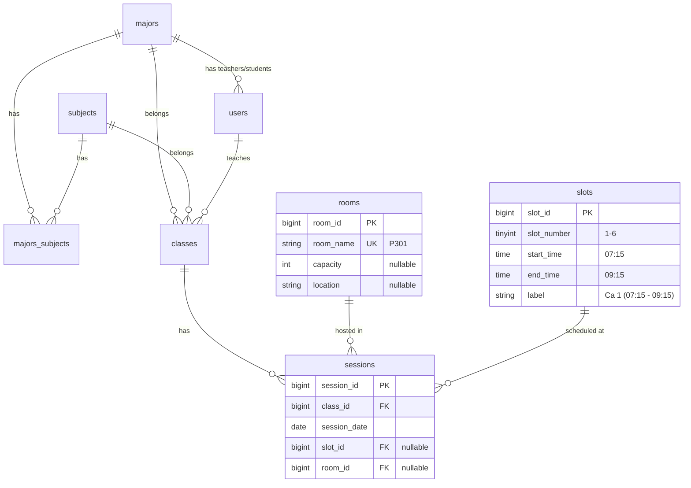
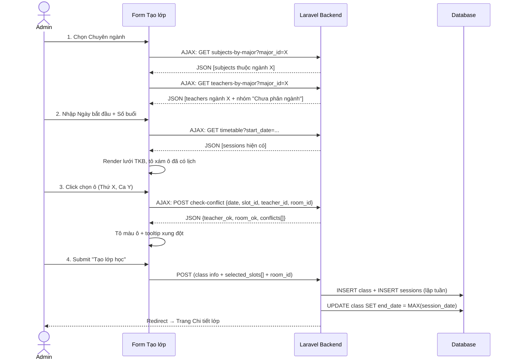

# Module Quản lý Lịch học — Kế hoạch Triển khai (Chính thức)

> **Trạng thái:** ✅ Đã duyệt — Sẵn sàng triển khai  
> **Nhánh Git:** `feature/admin-schedule-management`

---

## 1. Mục tiêu

Thiết kế lại form **Tạo/Sửa lớp học** thành giao diện quản lý lịch học chuyên nghiệp kiểu hệ thống quản lý đào tạo đại học:
1. **Form thông tin lớp** với dropdown liên kết thông minh (Chuyên ngành → Môn học → Giảng viên).
2. **Bảng thời khóa biểu dạng lưới** (Thứ 2 → CN × 6 ca) cho phép click-to-select tạo lịch định kỳ.
3. **Kiểm tra xung đột thời gian thực** (AJAX) cho Giảng viên / Phòng / Lớp.

---

## 2. Quyết định thiết kế (Đã xác nhận)

| # | Quyết định | Phương án chọn |
|---|-----------|---------------|
| Q1 | Phòng học gán chung hay riêng? | **Gán chung 1 phòng khi tạo.** Sửa riêng từng buổi ở trang Chi tiết (Show). |
| Q2 | Edit có thay đổi lịch? | **Không.** Edit chỉ sửa thông tin cơ bản (tên, GV, trạng thái). Lịch quản lý ở trang Show. |
| Q3 | GV chưa có chuyên ngành? | **Hiển thị nhóm "Chưa phân ngành"** ở cuối dropdown GV. |
| Q4 | Cột shift trong sessions? | **Tạo bảng `slots` riêng**, `sessions` tham chiếu `slot_id` FK thay vì text tự do. |

---

## 3. Thiết kế Database

### 3.1. Sơ đồ ER (Sau thay đổi)



### 3.2. Bảng mới: `slots`

| Cột | Kiểu | Mô tả |
|-----|------|-------|
| `slot_id` | BIGINT PK | Auto-increment |
| `slot_number` | TINYINT | 1 → 6 |
| `start_time` | TIME | Giờ bắt đầu |
| `end_time` | TIME | Giờ kết thúc |
| `label` | VARCHAR(50) | Nhãn hiển thị |

**Dữ liệu seed cố định:**

| slot_number | start_time | end_time | label |
|-------------|-----------|---------|-------|
| 1 | 07:15 | 09:15 | Ca 1 (07:15 – 09:15) |
| 2 | 09:25 | 11:25 | Ca 2 (09:25 – 11:25) |
| 3 | 12:00 | 14:00 | Ca 3 (12:00 – 14:00) |
| 4 | 14:10 | 16:10 | Ca 4 (14:10 – 16:10) |
| 5 | 16:20 | 18:20 | Ca 5 (16:20 – 18:20) |
| 6 | 18:30 | 20:30 | Ca 6 (18:30 – 20:30) |

### 3.3. Bảng mới: `rooms`

| Cột | Kiểu | Mô tả |
|-----|------|-------|
| `room_id` | BIGINT PK | Auto-increment |
| `room_name` | VARCHAR(50) UK | VD: P301, Lab-A |
| `capacity` | INT nullable | Sức chứa |
| `location` | VARCHAR(100) nullable | Vị trí / tòa nhà |

### 3.4. Thay đổi bảng `sessions`

```diff
 sessions
   session_id PK
   class_id FK
   session_date DATE
-  room VARCHAR(100) nullable
-  shift VARCHAR(50) nullable
+  slot_id FK → slots(slot_id) nullable
+  room_id FK → rooms(room_id) nullable
```

---

## 4. Thay đổi chi tiết theo Component

### Component 1: Database & Models

#### [NEW] Migration `create_slots_rooms_update_sessions`
- Tạo bảng `slots` (slot_id, slot_number, start_time, end_time, label)
- Tạo bảng `rooms` (room_id, room_name, capacity, location)
- Thêm cột `slot_id` (FK nullable) và `room_id` (FK nullable) vào `sessions`
- Xóa cột `room` (varchar) và `shift` (varchar) cũ

#### [NEW] Model `Slot` → `app/Models/Slot.php`
- `$table = 'slots'`, `$primaryKey = 'slot_id'`
- `$fillable = ['slot_number', 'start_time', 'end_time', 'label']`
- Quan hệ: `sessions() → hasMany(ClassSession)`

#### [NEW] Model `Room` → `app/Models/Room.php`
- `$table = 'rooms'`, `$primaryKey = 'room_id'`
- `$fillable = ['room_name', 'capacity', 'location']`
- Quan hệ: `sessions() → hasMany(ClassSession)`

#### [MODIFY] Model `ClassSession`
- `$fillable`: thay `'room', 'shift'` → `'slot_id', 'room_id'`
- Thêm quan hệ: `slot() → belongsTo(Slot)`, `room() → belongsTo(Room)`

#### [NEW] Seeder `SlotSeeder` — 6 ca cố định
#### [NEW] Seeder `RoomSeeder` — Dữ liệu phòng mẫu

---

### Component 2: Backend — Service & Controller

#### [MODIFY] `ClassService`
- **Viết lại `generateSessions()`**: Nhận mảng `selected_slots` `[{day_of_week, slot_id}]` + `room_id`, sinh buổi lặp theo tuần đến đủ `total_sessions`. Tự tính `end_date`.
- **Thêm `checkConflicts()`**: Kiểm tra xung đột GV/phòng/lớp cho 1 ô cụ thể.
- **Thêm `getExistingTimetable()`**: Lấy lịch hiện có từ ngày bắt đầu.

#### [MODIFY] `ClassController`
- Cập nhật `create()` / `edit()`: truyền `$rooms`, `$slots`
- Cập nhật `store()`: xử lý mảng `selected_slots`
- **Thêm 4 API methods**: `subjectsByMajor()`, `teachersByMajor()`, `timetable()`, `checkConflict()`

#### [MODIFY] `ClassRequest`
- Thêm validation cho `selected_slots` (array), `selected_slots.*.day_of_week` (0-6), `selected_slots.*.slot_id` (exists:slots)
- Bỏ rule `room`, `shift` (string cũ), `end_date` (tự tính)
- Thêm rule `room_id` (nullable, exists:rooms)

---

### Component 3: Frontend — Form view

#### [MODIFY] `form.blade.php` — Viết lại hoàn toàn

**Khu vực 1: Thông tin lớp** (Grid 2 cột, searchable dropdown)

| Trường | Loại | Ghi chú |
|--------|------|---------|
| Tên lớp * | text | VD: WD19301 |
| Chuyên ngành * | select | Khi chọn → AJAX load Môn + GV |
| Môn học * | select | Lọc theo chuyên ngành |
| Giảng viên * | select | Lọc theo chuyên ngành + nhóm "Chưa phân ngành" |
| Ngày bắt đầu * | date | Khi chọn → render lưới TKB |
| Số buổi học * | number | Min 1, Max 60 |
| Phòng học | select | Từ bảng `rooms` |
| Ngày kết thúc | readonly | Tự tính |
| Trạng thái * | select | Chưa mở / Đang học / Đã đóng |

**Khu vực 2: Bảng TKB** (7 cột × 6 hàng, click-to-select)

- 🟢 `bg-emerald-100` = Trống
- 🔵 `bg-indigo-500 text-white` = Đã chọn
- 🔴 `bg-rose-100 text-rose-700` = Xung đột
- ⬜ `bg-slate-100` = Đã có lịch lớp khác (hiển thị tên lớp)

---

### Component 4: Routes

```php
// API hỗ trợ form tạo lớp (AJAX, trong nhóm admin)
Route::prefix('classes/api')->name('classes.api.')->group(function () {
    Route::get('subjects-by-major', ...)->name('subjects');
    Route::get('teachers-by-major', ...)->name('teachers');
    Route::get('timetable',         ...)->name('timetable');
    Route::post('check-conflict',   ...)->name('conflict');
});
```

---

## 5. Luồng nghiệp vụ



---

## 6. Verification Plan

| Kiểm tra | Chi tiết |
|---------|---------|
| Migration | `php artisan migrate --seed` không lỗi |
| Cascade dropdown | Chọn ngành → Môn + GV đúng |
| Lưới TKB | Click ô → AJAX → đổi màu chính xác |
| Xung đột | 2 lớp cùng GV/phòng/ca → ô đỏ |
| Sinh buổi | Đủ `total_sessions`, `end_date` đúng |
| Responsive | Lưới TKB cuộn ngang mượt trên mobile |
| Edge cases | Chọn 0 ô, GV null ngành, ngày CN |
