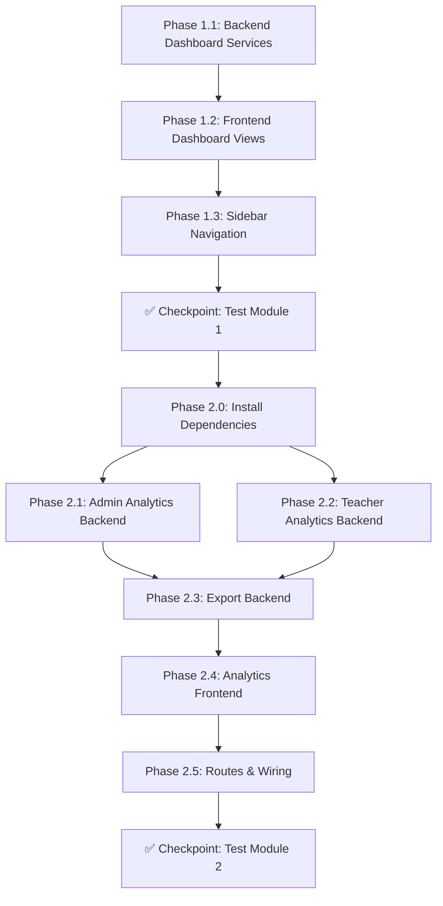

# Kế Hoạch Triển Khai: Dashboard & Thống Kê — Báo Cáo LMS

## Tổng Quan

Nâng cấp toàn diện hệ thống Dashboard cho cả 3 role (Admin, Teacher, Student) và xây dựng module **Thống kê & Báo cáo** mới dành riêng cho Admin và Teacher. Hệ thống áp dụng cơ chế **RBAC** (Role-Based Access Control) thông qua middleware `CheckRole` hiện có, đảm bảo Student chỉ truy cập được Dashboard.

> [!IMPORTANT]
> Dự án hiện chưa cài package xuất file (Maatwebsite/Excel, DomPDF). Cần cài đặt trước khi triển khai chức năng Export.

---

## User Review Required

> [!WARNING]
> **Về "Thống kê doanh thu"**: Hệ thống LMS hiện tại không có bảng/module quản lý học phí hay giao dịch tài chính. Trong kế hoạch này, tôi **bỏ qua thống kê doanh thu** để tránh phải thay đổi kiến trúc DB. Nếu bạn muốn bổ sung sau, cần thêm module Tài chính riêng.

> [!IMPORTANT]
> **Về thư viện biểu đồ**: Kế hoạch sử dụng **Chart.js (CDN)** — thư viện nhẹ, không cần build step, phù hợp với stack Blade + CDN hiện tại.

> [!IMPORTANT]
> **Về xuất file**: Sử dụng **Maatwebsite/Laravel-Excel** cho Excel và **barryvdh/laravel-dompdf** cho PDF. Cần chạy `composer require` trước khi bắt đầu Module 2.

---

## Open Questions

1. **Phạm vi bộ lọc cho Teacher**: Teacher có thể xem thống kê toàn bộ hệ thống hay chỉ giới hạn trong các lớp mình phụ trách? → **Kế hoạch mặc định: chỉ lớp của mình** (phù hợp RBAC).
2. **Có cần lưu lịch sử báo cáo đã xuất không?** → **Kế hoạch mặc định: không lưu**, xuất trực tiếp rồi download.

---

## Kiến Trúc Tổng Thể

```
┌─────────────────────────────────────────────────────────┐
│                   MODULE 1: DASHBOARD                    │
├──────────────┬──────────────────┬────────────────────────┤
│  Admin       │  Teacher         │  Student               │
│  Dashboard   │  Dashboard       │  Dashboard             │
│  (Nâng cấp)  │  (Nâng cấp)      │  (Nâng cấp)            │
│  + Biểu đồ   │  + Biểu đồ       │  + Biểu đồ tiến độ     │
│  + Realtime   │  + Quick actions  │  + Lịch trình          │
│  + Trends     │  + Tiến độ chi    │  + Bài tập & điểm      │
│              │    tiết lớp       │                        │
├──────────────┴──────────────────┴────────────────────────┤
│                                                          │
│            MODULE 2: THỐNG KÊ & BÁO CÁO                 │
│            (Chỉ Admin + Teacher — RBAC)                  │
├──────────────┬──────────────────┬────────────────────────┤
│  Bộ lọc      │  Thống kê nội    │  Xuất báo cáo          │
│  thông minh  │  dung            │                        │
│              │                  │                        │
│  · Thời gian │  · Điểm số       │  · Excel (xlsx)        │
│  · Ngành     │  · Điểm danh     │  · PDF                 │
│  · Môn học   │  · Khóa học      │  · In trực tiếp        │
│  · Lớp      │  · Người dùng    │                        │
│  · GV/SV    │                  │                        │
└──────────────┴──────────────────┴────────────────────────┘
```

### RBAC Access Matrix

| Chức năng | Admin | Teacher | Student |
|---|:---:|:---:|:---:|
| Dashboard (xem tổng quan) | ✅ | ✅ | ✅ |
| Dashboard biểu đồ | ✅ | ✅ | ✅ (giới hạn) |
| Thống kê điểm | ✅ (toàn hệ thống) | ✅ (lớp của mình) | ❌ |
| Thống kê điểm danh | ✅ (toàn hệ thống) | ✅ (lớp của mình) | ❌ |
| Thống kê khóa học | ✅ | ❌ | ❌ |
| Thống kê người dùng | ✅ | ❌ | ❌ |
| Xuất Excel/PDF | ✅ | ✅ (lớp của mình) | ❌ |
| In báo cáo | ✅ | ✅ | ❌ |

---

## Proposed Changes

Chia thành **2 Module chính**, mỗi Module chia thành **các Phase nhỏ** để phù hợp với quá trình làm việc ngắt quãng.

---

### MODULE 1: DASHBOARD (Nâng cấp giao diện + dữ liệu)

**Branch**: `feature/dashboard-redesign`

#### Phase 1.1 — Backend: Nâng cấp Dashboard Service

> Mục tiêu: Bổ sung dữ liệu cho biểu đồ và widget mới, không phá vỡ logic cũ.

##### Task 1.1.1 — Admin DashboardService

[MODIFY] [DashboardService.php](file:///c:/xampp/htdocs/SDLC_LMS_SE08201/LMS_SDLC_SE08201/app/Services/Admin/DashboardService.php)

Bổ sung dữ liệu mới vào `getStats()` phục vụ layout 2 cột:

**Dữ liệu cho KPI Cards (giữ + bổ sung):**
- Giữ nguyên: `total_users`, `total_students`, `total_teachers`, `total_majors`, `total_subjects`, `total_classes`, `active_classes`
- Bổ sung: `pending_assignments` (bài tập đang chờ nộp toàn hệ thống), `attendance_rate` (tỷ lệ chuyên cần tổng)

**Dữ liệu cho Khung trái (biểu đồ):**
- **Xu hướng điểm trung bình theo kỳ**: query `submissions` join `assignments` → group by tháng/kỳ → `[{period, avg_score}]` cho line chart
- **Tỷ lệ phân bố điểm**: đếm submissions theo khoảng điểm (0-2, 2-4, 4-6, 6-8, 8-10) → doughnut chart
- **Tỷ lệ sinh viên theo ngành**: query `users` WHERE role=STUDENT join `majors` group by `major_name` → doughnut/pie chart
- **Top môn có tỷ lệ điểm cao nhất**: query avg(score) group by subject → sắp giảm dần → horizontal bar chart
- **Tỷ lệ điểm danh / nghỉ học**: đếm attendances theo status P/A/L → pie chart
- **Lịch học hôm nay**: query `sessions` WHERE `session_date = today` with classRoom, subject, slot, room → bảng

**Dữ liệu cho Khung phải (bảng):**
- Giữ nguyên: `recent_notifications` (thông báo hệ thống gần đây)
- Bổ sung: `upcoming_assignments` — top 8 bài tập sắp đến hạn (toàn hệ thống), where `due_date > now()` order by `due_date`
- Bổ sung: `system_status` — thống kê trạng thái hệ thống: tổng user online (estimated), số lớp đang hoạt động, số bài tập đang mở, số bài chờ chấm

##### Task 1.1.2 — Teacher DashboardService

[MODIFY] [TeacherDashboardService.php](file:///c:/xampp/htdocs/SDLC_LMS_SE08201/LMS_SDLC_SE08201/app/Services/Teacher/TeacherDashboardService.php)

Bổ sung vào `getStats()`:
- **Tỷ lệ chuyên cần trung bình** (các lớp mình dạy): query `attendances` join `sessions` → %
- **Phân bố điểm số** (các lớp mình): query `submissions` where `score is not null` → histogram data
- **Tỷ lệ nộp bài**: tổng submissions / tổng enrollment × assignments → % 
- **Hoạt động thảo luận gần đây**: top 5 discussions mới nhất trong lớp mình

##### Task 1.1.3 — Student DashboardService

[MODIFY] [StudentDashboardService.php](file:///c:/xampp/htdocs/SDLC_LMS_SE08201/LMS_SDLC_SE08201/app/Services/Student/StudentDashboardService.php)

Bổ sung vào `getStats()`:
- **Tiến trình hoàn thành bài tập**: (đã nộp / tổng bài tập) × 100 per class → progress bars
- **Lịch sử điểm** (trend): điểm các bài tập theo thời gian → line chart mini
- **Thống kê chuyên cần cá nhân**: {P, A, L} count → pie chart nhỏ

---

#### Phase 1.2 — Frontend: Redesign Dashboard Views

> Mục tiêu: Giao diện hiện đại, có biểu đồ Chart.js, responsive, dark/light card.

##### Task 1.2.1 — Thêm Chart.js CDN vào layout

[MODIFY] [app.blade.php](file:///c:/xampp/htdocs/SDLC_LMS_SE08201/LMS_SDLC_SE08201/resources/views/layouts/app.blade.php)

- Thêm `<script src="https://cdn.jsdelivr.net/npm/chart.js"></script>` vào `<head>`
- Thêm `@stack('scripts')` trước `</body>` để các view con push script biểu đồ

##### Task 1.2.2 — Redesign Admin Dashboard View

[MODIFY] [dashboard.blade.php](file:///c:/xampp/htdocs/SDLC_LMS_SE08201/LMS_SDLC_SE08201/resources/views/admin/dashboard.blade.php)

Bố cục Desktop mới — **2 cột chính** dưới KPI cards:

```
┌─────────────────────────────────────────────────────────────────────────────────┐
│  ROW 0: KPI CARDS (full-width, 4-5 cards hàng ngang)                           │
│  ┌──────────┐ ┌──────────┐ ┌──────────┐ ┌──────────┐ ┌──────────┐             │
│  │ Tổng     │ │ Lớp học  │ │ Môn học  │ │ Chuyên   │ │ Chuyên   │             │
│  │ người    │ │          │ │          │ │ ngành    │ │ cần (%)  │             │
│  │ dùng     │ │          │ │          │ │          │ │          │             │
│  └──────────┘ └──────────┘ └──────────┘ └──────────┘ └──────────┘             │
├─────────────────────────────────────────────┬───────────────────────────────────┤
│  KHUNG TRÁI (col-span-8, ~66%)              │  KHUNG PHẢI (col-span-4, ~34%)    │
│                                             │                                   │
│  ┌─────────────────────────────────────┐    │  ┌───────────────────────────────┐│
│  │ 📈 Biểu đồ ĐƯỜNG                   │    │  │ 📢 THÔNG BÁO HỆ THỐNG        ││
│  │ Xu hướng điểm trung bình theo kỳ   │    │  │ (Danh sách thông báo mới      ││
│  │ (Line Chart — trục X: kỳ/tháng)    │    │  │  với scroll, badge, timestamp) ││
│  └─────────────────────────────────────┘    │  └───────────────────────────────┘│
│                                             │                                   │
│  ┌────────────────┐ ┌────────────────┐      │  ┌───────────────────────────────┐│
│  │ 🍩 DOUGHNUT    │ │ 🍩 DOUGHNUT   │      │  │ ⏰ BÀI TẬP SẮP ĐẾN HẠN       ││
│  │ Tỷ lệ phân bố │ │ Tỷ lệ SV      │      │  │ (Danh sách top 8 bài tập     ││
│  │ điểm (0-10)   │ │ theo ngành     │      │  │  sắp due, hiển thị countdown,││
│  └────────────────┘ └────────────────┘      │  │  tên lớp, tên GV)            ││
│                                             │  └───────────────────────────────┘│
│  ┌─────────────────────────────────────┐    │                                   │
│  │ 📊 Biểu đồ CỘT NGANG              │    │  ┌───────────────────────────────┐│
│  │ Top môn có tỷ lệ điểm cao nhất     │    │  │ 🖥️ TRẠNG THÁI HỆ THỐNG       ││
│  │ (Horizontal Bar — trục Y: tên môn) │    │  │ • Lớp đang hoạt động: X       ││
│  └─────────────────────────────────────┘    │  │ • Bài tập đang mở: X          ││
│                                             │  │ • Bài chờ chấm: X             ││
│  ┌─────────────────────────────────────┐    │  │ • Thảo luận mới hôm nay: X    ││
│  │ 🥧 Biểu đồ TRÒN                    │    │  │ • Người dùng mới (7 ngày): X  ││
│  │ Tỷ lệ điểm danh / nghỉ học (P/A/L)│    │  └───────────────────────────────┘│
│  └─────────────────────────────────────┘    │                                   │
│                                             │                                   │
│  ┌─────────────────────────────────────┐    │                                   │
│  │ 📅 BẢNG LỊCH HỌC HÔM NAY          │    │                                   │
│  │ (Table: Thời gian, Lớp, Môn,       │    │                                   │
│  │  Phòng, Giảng viên, Slot)          │    │                                   │
│  └─────────────────────────────────────┘    │                                   │
├─────────────────────────────────────────────┴───────────────────────────────────┤
│  Responsive: Trên mobile/tablet, 2 cột stack thành 1 cột (khung phải xuống    │
│  dưới khung trái). KPI cards chuyển thành 2 cols trên mobile.                  │
└────────────────────────────────────────────────────────────────────────────────┘
```

**Chi tiết từng component:**

| # | Component | Loại | Chi tiết |
|---|---|---|---|
| 1 | KPI Cards | Gradient cards | 5 cards: Tổng user (SV/GV), Lớp học (active), Môn học, Chuyên ngành, Chuyên cần (%) |
| 2 | Xu hướng điểm TB | Line Chart | Trục X = tháng (6 tháng gần nhất), Trục Y = điểm TB, data từ submissions |
| 3 | Tỷ lệ phân bố điểm | Doughnut | 5 khoảng: 0-2, 2-4, 4-6, 6-8, 8-10 với màu gradient |
| 4 | Tỷ lệ SV theo ngành | Doughnut | Mỗi ngành 1 màu, legend bên cạnh |
| 5 | Top môn điểm cao | Horiz. Bar | Top 8 môn, trục Y = tên môn, trục X = điểm TB |
| 6 | Tỷ lệ điểm danh | Pie Chart | 3 phần: Có mặt (P), Vắng (A), Muộn (L) |
| 7 | Lịch học hôm nay | Table | Cột: STT, Slot/Ca, Lớp, Môn, Phòng, GV |
| 8 | Thông báo HT | List panel | Scroll max-height, mỗi item: icon + title + time |
| 9 | Bài tập sắp hạn | List panel | Countdown badge (đỏ nếu <24h), tên lớp, GV |
| 10 | Trạng thái HT | Stat panel | Key-value list với icon + số liệu realtime |

##### Task 1.2.3 — Redesign Teacher Dashboard View

[MODIFY] [dashboard.blade.php](file:///c:/xampp/htdocs/SDLC_LMS_SE08201/LMS_SDLC_SE08201/resources/views/teacher/dashboard.blade.php)

Cấu trúc mới:
```
┌─ Row 1: 4 Stat Cards (Lớp, SV, Chờ chấm, Chuyên cần TB) ────────────────────────┐
├─ Row 2: 2 Charts ─────────────────────────────────────────────────────────────────┤
│  [Bar Chart: Phân bố điểm số]            [Doughnut: Tỷ lệ nộp bài]               │
├─ Row 3: 2 Panels ─────────────────────────────────────────────────────────────────┤
│  [Lịch dạy tuần này (giữ)]              [Tiến độ lớp (giữ, cải thiện UI)]        │
├─ Row 4: 2 Panels ─────────────────────────────────────────────────────────────────┤
│  [Thảo luận gần đây]                    [Thông báo mới]                           │
└───────────────────────────────────────────────────────────────────────────────────┘
```

##### Task 1.2.4 — Redesign Student Dashboard View

[MODIFY] [dashboard.blade.php](file:///c:/xampp/htdocs/SDLC_LMS_SE08201/LMS_SDLC_SE08201/resources/views/student/dashboard.blade.php)

Cấu trúc mới:
```
┌─ Row 1: 4 Stat Cards (Lớp, Điểm TB, Chuyên cần, Bài tập chưa nộp) ──────────────┐
├─ Row 2: 2 Charts ─────────────────────────────────────────────────────────────────┤
│  [Line Chart: Trend điểm số]             [Doughnut: Chuyên cần P/A/L]             │
├─ Row 3: 2 Panels ─────────────────────────────────────────────────────────────────┤
│  [Bài tập sắp đến hạn (giữ)]            [Lịch học tuần (giữ)]                    │
├─ Row 4: 2 Panels ─────────────────────────────────────────────────────────────────┤
│  [Tiến trình hoàn thành bài tập/lớp]    [Kết quả + Thông báo (giữ)]              │
└───────────────────────────────────────────────────────────────────────────────────┘
```

---

#### Phase 1.3 — Cập nhật Sidebar & Navigation

##### Task 1.3.1 — Thêm menu "Thống kê & Báo cáo" vào sidebar

[MODIFY] [app.blade.php](file:///c:/xampp/htdocs/SDLC_LMS_SE08201/LMS_SDLC_SE08201/resources/views/layouts/app.blade.php)

- Thêm link `📈 Thống kê & Báo cáo` vào sidebar cho **Admin** (route: `admin.analytics.index`)
- Thêm link `📈 Thống kê lớp` vào sidebar cho **Teacher** (route: `teacher.analytics.index`)
- **KHÔNG thêm cho Student** (theo RBAC)

---

### MODULE 2: THỐNG KÊ & BÁO CÁO (Chức năng mới)

**Branch**: `feature/analytics-reports`  
**Phụ thuộc**: Module 1 (cần Chart.js đã có trong layout)

#### Phase 2.0 — Cài đặt Dependencies

##### Task 2.0.1 — Cài package xuất file

```bash
composer require maatwebsite/excel
composer require barryvdh/laravel-dompdf
```

---

#### Phase 2.1 — Backend: Admin Analytics

> Tạo các file MỚI theo đúng quy tắc Clean Extension, không sửa file cũ.

##### Task 2.1.1 — Admin Analytics Service

[NEW] `app/Services/Admin/AnalyticsService.php`

Class chịu trách nhiệm query dữ liệu thống kê phức tạp cho Admin:

| Method | Mô tả | Dữ liệu input (filters) |
|---|---|---|
| `getGradeStats(filters)` | Thống kê điểm: trung bình, cao nhất, thấp nhất, phân bố theo khoảng điểm | Thời gian, Ngành, Môn, Lớp, GV |
| `getAttendanceStats(filters)` | Thống kê chuyên cần: tỷ lệ P/A/L, trend theo tuần/tháng | Thời gian, Ngành, Môn, Lớp, GV |
| `getCourseStats(filters)` | Thống kê khóa học: số lớp, trạng thái, tiến độ, tỷ lệ hoàn thành | Thời gian, Ngành, Môn |
| `getUserStats(filters)` | Thống kê người dùng: phân bổ role, ngành, trend đăng ký | Thời gian, Ngành |
| `buildFilterQuery(filters)` | Helper: xây dựng query builder từ bộ lọc chung | — |

##### Task 2.1.2 — Admin Analytics Controller

[NEW] `app/Http/Controllers/Admin/AnalyticsController.php`

| Method | Route | Mô tả |
|---|---|---|
| `index()` | GET `admin/analytics` | Trang chính thống kê, hiển thị tất cả tabs |
| `grades()` | GET `admin/analytics/grades` | AJAX: trả về data thống kê điểm theo filter |
| `attendance()` | GET `admin/analytics/attendance` | AJAX: trả về data thống kê chuyên cần theo filter |
| `courses()` | GET `admin/analytics/courses` | AJAX: trả về data thống kê khóa học |
| `users()` | GET `admin/analytics/users` | AJAX: trả về data thống kê người dùng |

##### Task 2.1.3 — Admin Analytics Form Request

[NEW] `app/Http/Requests/Admin/AnalyticsFilterRequest.php`

Validate các filter params:
- `date_from` — nullable|date
- `date_to` — nullable|date|after_or_equal:date_from  
- `major_id` — nullable|exists:majors,major_id
- `subject_id` — nullable|exists:subjects,subject_id
- `class_id` — nullable|exists:classes,class_id
- `teacher_id` — nullable|exists:users,user_id
- `student_id` — nullable|exists:users,user_id

---

#### Phase 2.2 — Backend: Teacher Analytics

##### Task 2.2.1 — Teacher Analytics Service

[NEW] `app/Services/Teacher/TeacherAnalyticsService.php`

| Method | Mô tả |
|---|---|
| `getGradeStats(teacher, filters)` | Thống kê điểm các lớp của teacher (filter theo lớp, thời gian) |
| `getAttendanceStats(teacher, filters)` | Thống kê chuyên cần các lớp teacher đứng |
| `getClassOverview(teacher)` | Tổng quan các lớp: tiến độ, sĩ số, completion rate |

##### Task 2.2.2 — Teacher Analytics Controller

[NEW] `app/Http/Controllers/Teacher/AnalyticsController.php`

| Method | Route | Mô tả |
|---|---|---|
| `index()` | GET `teacher/analytics` | Trang thống kê cho GV |
| `grades()` | GET `teacher/analytics/grades` | AJAX: data điểm theo filter |
| `attendance()` | GET `teacher/analytics/attendance` | AJAX: data chuyên cần |

##### Task 2.2.3 — Teacher Analytics Form Request

[NEW] `app/Http/Requests/Teacher/TeacherAnalyticsFilterRequest.php`

Validate (giới hạn hơn Admin):
- `date_from`, `date_to` — nullable|date
- `class_id` — nullable|exists:classes,class_id (sẽ kiểm tra ownership trong Service)

---

#### Phase 2.3 — Backend: Xuất Báo Cáo (Export)

##### Task 2.3.1 — Export Service

[NEW] `app/Services/Shared/ReportExportService.php`

Service dùng chung cho cả Admin và Teacher:

| Method | Mô tả |
|---|---|
| `exportGradesExcel(data, filters)` | Xuất bảng điểm ra file .xlsx |
| `exportAttendanceExcel(data, filters)` | Xuất bảng chuyên cần ra file .xlsx |
| `exportCourseExcel(data, filters)` | Xuất thống kê khóa học (chỉ Admin) |
| `exportUserExcel(data, filters)` | Xuất danh sách người dùng (chỉ Admin) |
| `exportPdf(view, data, filename)` | Xuất bất kỳ view nào ra PDF |

##### Task 2.3.2 — Excel Export Classes (Maatwebsite)

[NEW] `app/Exports/GradeReportExport.php`  
[NEW] `app/Exports/AttendanceReportExport.php`  
[NEW] `app/Exports/CourseReportExport.php`  
[NEW] `app/Exports/UserReportExport.php`

Mỗi class implement `FromCollection`, `WithHeadings`, `WithMapping`, `ShouldAutoSize`.

##### Task 2.3.3 — Export Controller

[NEW] `app/Http/Controllers/Admin/ReportController.php`

| Method | Route | Mô tả |
|---|---|---|
| `exportGrades(request)` | GET `admin/reports/grades/export` | Download Excel/PDF điểm |
| `exportAttendance(request)` | GET `admin/reports/attendance/export` | Download Excel/PDF chuyên cần |
| `exportCourses(request)` | GET `admin/reports/courses/export` | Download Excel/PDF khóa học |
| `exportUsers(request)` | GET `admin/reports/users/export` | Download Excel/PDF người dùng |

[NEW] `app/Http/Controllers/Teacher/ReportController.php`

| Method | Route | Mô tả |
|---|---|---|
| `exportGrades(request)` | GET `teacher/reports/grades/export` | Download Excel/PDF điểm lớp mình |
| `exportAttendance(request)` | GET `teacher/reports/attendance/export` | Download chuyên cần lớp mình |

---

#### Phase 2.4 — Frontend: Giao Diện Thống Kê

##### Task 2.4.1 — Admin Analytics View (Trang chính)

[NEW] `resources/views/admin/analytics/index.blade.php`

Thiết kế layout:
```
┌─ Header: "Thống kê & Báo cáo" ───────────────────────────────────────────────────┐
├─ Filter Bar (sticky) ─────────────────────────────────────────────────────────────┤
│  [Từ ngày] [Đến ngày] [Ngành ▾] [Môn ▾] [Lớp ▾] [GV ▾] [SV ▾] [🔍 Lọc] [↻ Reset]│
├─ Tab Navigation ──────────────────────────────────────────────────────────────────┤
│  [ Điểm số ] [ Chuyên cần ] [ Khóa học ] [ Người dùng ]                          │
├─ Tab Content (AJAX load) ─────────────────────────────────────────────────────────┤
│                                                                                   │
│  Mỗi tab gồm:                                                                    │
│  ┌─ Summary Cards (4 cols) ─────────────────────────────────────┐                │
│  ├─ Charts (2 cols) ────────────────────────────────────────────┤                │
│  │  [Chart 1: Biểu đồ chính]        [Chart 2: Biểu đồ phụ]    │                │
│  ├─ Data Table ─────────────────────────────────────────────────┤                │
│  │  [Bảng dữ liệu chi tiết + pagination]                       │                │
│  ├─ Export Bar ─────────────────────────────────────────────────┤                │
│  │  [📥 Xuất Excel] [📄 Xuất PDF] [🖨️ In báo cáo]              │                │
│  └──────────────────────────────────────────────────────────────┘                │
└───────────────────────────────────────────────────────────────────────────────────┘
```

##### Task 2.4.2 — Admin Analytics Partials (Tab Content)

[NEW] `resources/views/admin/analytics/partials/grades.blade.php` — Tab Điểm số  
[NEW] `resources/views/admin/analytics/partials/attendance.blade.php` — Tab Chuyên cần  
[NEW] `resources/views/admin/analytics/partials/courses.blade.php` — Tab Khóa học  
[NEW] `resources/views/admin/analytics/partials/users.blade.php` — Tab Người dùng

##### Task 2.4.3 — PDF Report Templates

[NEW] `resources/views/admin/reports/pdf/grades.blade.php`  
[NEW] `resources/views/admin/reports/pdf/attendance.blade.php`  
[NEW] `resources/views/admin/reports/pdf/courses.blade.php`  
[NEW] `resources/views/admin/reports/pdf/users.blade.php`

Mỗi template sử dụng style inline (yêu cầu của DomPDF), bao gồm header trường, ngày xuất, nội dung bảng, footer.

##### Task 2.4.4 — Teacher Analytics View

[NEW] `resources/views/teacher/analytics/index.blade.php`

Layout tương tự Admin nhưng:
- Bộ lọc chỉ có: `[Lớp ▾] [Từ ngày] [Đến ngày] [🔍 Lọc]`
- Chỉ có 2 tab: `[ Điểm số ] [ Chuyên cần ]`
- Dropdown lớp chỉ hiển thị lớp teacher đang phụ trách

[NEW] `resources/views/teacher/analytics/partials/grades.blade.php`  
[NEW] `resources/views/teacher/analytics/partials/attendance.blade.php`

---

#### Phase 2.5 — Routes & Wiring

##### Task 2.5.1 — Đăng ký Routes

[MODIFY] [web.php](file:///c:/xampp/htdocs/SDLC_LMS_SE08201/LMS_SDLC_SE08201/routes/web.php)

Thêm vào nhóm Admin (sau notifications):
```php
// Thống kê & Báo cáo
Route::prefix('analytics')->name('analytics.')->group(function () {
    Route::get('/', [Admin\AnalyticsController::class, 'index'])->name('index');
    Route::get('/grades', [Admin\AnalyticsController::class, 'grades'])->name('grades');
    Route::get('/attendance', [Admin\AnalyticsController::class, 'attendance'])->name('attendance');
    Route::get('/courses', [Admin\AnalyticsController::class, 'courses'])->name('courses');
    Route::get('/users', [Admin\AnalyticsController::class, 'users'])->name('users');
});
Route::prefix('reports')->name('reports.')->group(function () {
    Route::get('/grades/export', [Admin\ReportController::class, 'exportGrades'])->name('grades.export');
    Route::get('/attendance/export', [Admin\ReportController::class, 'exportAttendance'])->name('attendance.export');
    Route::get('/courses/export', [Admin\ReportController::class, 'exportCourses'])->name('courses.export');
    Route::get('/users/export', [Admin\ReportController::class, 'exportUsers'])->name('users.export');
});
```

Thêm vào nhóm Teacher (sau discussions):
```php
// Thống kê lớp
Route::prefix('analytics')->name('analytics.')->group(function () {
    Route::get('/', [Teacher\AnalyticsController::class, 'index'])->name('index');
    Route::get('/grades', [Teacher\AnalyticsController::class, 'grades'])->name('grades');
    Route::get('/attendance', [Teacher\AnalyticsController::class, 'attendance'])->name('attendance');
});
Route::prefix('reports')->name('reports.')->group(function () {
    Route::get('/grades/export', [Teacher\ReportController::class, 'exportGrades'])->name('grades.export');
    Route::get('/attendance/export', [Teacher\ReportController::class, 'exportAttendance'])->name('attendance.export');
});
```

---

## Tổng hợp File Changes

### Module 1 — Dashboard Redesign

| Loại | File | Mô tả |
|---|---|---|
| MODIFY | `app/Services/Admin/DashboardService.php` | Bổ sung data chart |
| MODIFY | `app/Services/Teacher/TeacherDashboardService.php` | Bổ sung data chart |
| MODIFY | `app/Services/Student/StudentDashboardService.php` | Bổ sung data chart |
| MODIFY | `resources/views/layouts/app.blade.php` | Chart.js CDN + @stack + menu sidebar |
| MODIFY | `resources/views/admin/dashboard.blade.php` | Redesign + charts |
| MODIFY | `resources/views/teacher/dashboard.blade.php` | Redesign + charts |
| MODIFY | `resources/views/student/dashboard.blade.php` | Redesign + charts |

### Module 2 — Thống kê & Báo cáo

| Loại | File | Mô tả |
|---|---|---|
| NEW | `app/Services/Admin/AnalyticsService.php` | Query thống kê Admin |
| NEW | `app/Services/Teacher/TeacherAnalyticsService.php` | Query thống kê Teacher |
| NEW | `app/Services/Shared/ReportExportService.php` | Logic xuất file chung |
| NEW | `app/Http/Controllers/Admin/AnalyticsController.php` | API thống kê Admin |
| NEW | `app/Http/Controllers/Admin/ReportController.php` | Xuất báo cáo Admin |
| NEW | `app/Http/Controllers/Teacher/AnalyticsController.php` | API thống kê Teacher |
| NEW | `app/Http/Controllers/Teacher/ReportController.php` | Xuất báo cáo Teacher |
| NEW | `app/Http/Requests/Admin/AnalyticsFilterRequest.php` | Validate filter Admin |
| NEW | `app/Http/Requests/Teacher/TeacherAnalyticsFilterRequest.php` | Validate filter Teacher |
| NEW | `app/Exports/GradeReportExport.php` | Excel export điểm |
| NEW | `app/Exports/AttendanceReportExport.php` | Excel export chuyên cần |
| NEW | `app/Exports/CourseReportExport.php` | Excel export khóa học |
| NEW | `app/Exports/UserReportExport.php` | Excel export người dùng |
| NEW | `resources/views/admin/analytics/index.blade.php` | Trang thống kê Admin |
| NEW | `resources/views/admin/analytics/partials/grades.blade.php` | Tab điểm |
| NEW | `resources/views/admin/analytics/partials/attendance.blade.php` | Tab chuyên cần |
| NEW | `resources/views/admin/analytics/partials/courses.blade.php` | Tab khóa học |
| NEW | `resources/views/admin/analytics/partials/users.blade.php` | Tab người dùng |
| NEW | `resources/views/admin/reports/pdf/grades.blade.php` | PDF template điểm |
| NEW | `resources/views/admin/reports/pdf/attendance.blade.php` | PDF template chuyên cần |
| NEW | `resources/views/admin/reports/pdf/courses.blade.php` | PDF template khóa học |
| NEW | `resources/views/admin/reports/pdf/users.blade.php` | PDF template người dùng |
| NEW | `resources/views/teacher/analytics/index.blade.php` | Trang thống kê Teacher |
| NEW | `resources/views/teacher/analytics/partials/grades.blade.php` | Tab điểm Teacher |
| NEW | `resources/views/teacher/analytics/partials/attendance.blade.php` | Tab chuyên cần Teacher |
| MODIFY | `routes/web.php` | Thêm routes analytics & reports |

---

## Verification Plan

### Automated Tests

```bash
# Kiểm tra syntax toàn bộ PHP
php artisan route:list --compact
php artisan view:cache
php artisan view:clear
```

### Manual Verification

1. **Dashboard**: Đăng nhập lần lượt bằng 3 tài khoản (Admin, Teacher, Student) → kiểm tra hiển thị đúng dữ liệu, biểu đồ render, responsive mobile.
2. **RBAC**: Student truy cập `/admin/analytics` → phải bị chặn 403. Teacher truy cập `/admin/analytics` → cũng 403.
3. **Bộ lọc**: Chọn filter theo ngành, môn, lớp → data biểu đồ và bảng cập nhật đúng.
4. **Export Excel**: Click xuất → file .xlsx download thành công, mở được, data đúng.
5. **Export PDF**: Click xuất → file .pdf download thành công, format đẹp, có header trường.
6. **In báo cáo**: Click In → cửa sổ print của browser mở, layout phù hợp A4.
7. **Teacher scope**: Teacher chỉ thấy dữ liệu lớp mình, không thấy lớp người khác.

---

## Thứ tự triển khai đề xuất



> Mỗi Phase có thể được commit độc lập và test riêng, phù hợp với làm việc ngắt quãng.
